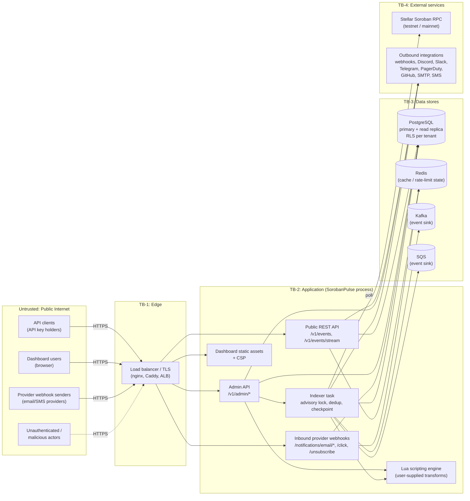

# SorobanPulse Threat Model

**Status:** Living document  
**Reviewed by:** _(requires two maintainer approvals before merging — see acceptance criteria)_  
**Last updated:** 2026-09-28

---

## 1. Scope

This document covers the SorobanPulse backend service and all components it directly controls:

| Component | Description |
|---|---|
| REST API (Axum) | Public HTTP endpoints, admin endpoints, SSE streams |
| Indexer | Background Tokio task polling Stellar Soroban RPC |
| PostgreSQL | Primary data store + advisory lock |
| Outbound Integrations | Webhooks, Discord, Slack, Telegram, PagerDuty, email (SMTP), SMS, GitHub |
| Admin API | Pause/resume indexer, replay, anonymize, schema/ABI management |
| Multi-tenant layer | Per-tenant RLS, API key scoping, data isolation |
| Lua scripting engine | User-supplied transform/filter scripts |
| Email subsystem | Tracking pixel, click redirect, unsubscribe, bounce endpoints |

Out of scope for this document: Stellar network / Soroban RPC infrastructure, infrastructure managed by cloud providers (VMs, managed Postgres, load balancers), CI/CD pipeline, DNS/TLS termination.

---

## 2. Data Flow Diagram

**Trust boundaries:**

| # | Boundary | Notes |
|---|---|---|
| TB-1 | Public Internet → Load Balancer | TLS termination; rate limiting |
| TB-2 | Load Balancer → API / Admin API / Inbound webhooks / Dashboard | Internal HTTP only; LB enforces IP allowlisting for admin |
| TB-3 | API → PostgreSQL / Redis / Kafka / SQS | Parameterised queries; RLS; advisory lock; sinks are operator-configured |
| TB-4 | Indexer ↔ Stellar RPC | Untrusted external service; response data validated before insertion |
| TB-5 | API / Indexer → Outbound Integrations | User-controlled URLs; must go through SSRF guard |
| TB-6 | Internet → Email sub-endpoints & inbound provider webhooks | Unauthenticated by design; HMAC tokens + provider signatures + rate limits required |
| TB-7 | Admin API → Internal state | Separate `ADMIN_API_KEY` (fail-closed); audit logging |
| TB-8 | Multi-tenant → DB | Row-Level Security per tenant; key scoping |
| TB-9 | Lua sandbox → Host | Script isolation; resource limits |

---

## 2a. Assets

| Asset | Sensitivity | Where it lives |
|---|---|---|
| Event data (per tenant) | Confidential (tenant-scoped) | PostgreSQL |
| Tenant API keys / admin API key | Secret | Env vars, request headers |
| Integration credentials (`integration_secrets.rs`) | Secret | PostgreSQL (encrypted at rest by operator) |
| Webhook signing secrets | Secret | PostgreSQL |
| Email tracking / unsubscribe tokens | Sensitive (bearer-like) | URLs in outbound email |
| Audit log | Integrity-critical | PostgreSQL (`audit_logs`) |
| Indexer checkpoint / advisory lock | Integrity-critical | PostgreSQL |
| Lua scripts | Untrusted input | PostgreSQL, executed in-process |
| Dashboard assets | Public | Static files served by API |
| Metrics (`/metrics`) | Internal | Prometheus scrape |
=======

---

## 3. STRIDE Analysis

### 3.1 REST API (`/v1/events`, `/v1/events/stream`, `/v1/events/tx/*`)

| Threat | Category | Existing Mitigations | Gaps / Follow-up |
|---|---|---|---|
| Unauthenticated bulk export of all events | **S** (Spoofing) / **I** (Info Disclosure) | `API_KEY` bearer/X-Api-Key gate when configured | API key is optional — operators may forget to set it |
| Exhausting DB connections via concurrent slow queries | **D** (Denial of Service) | `DB_MAX_CONNECTIONS`, rate limiting per IP | No per-query timeout enforced at the query layer (only `SLOW_QUERY_THRESHOLD_MS` for logging) |
| Injecting malicious `event_type` / filter values | **T** (Tampering) | SQLx parameterised queries; enum validation | Low residual risk; no gap |
| SSE stream holds connections open indefinitely | **D** | Keep-alive pings; client disconnect cleanup | No hard connection-time limit per client |
| Cursor/pagination token forgery | **E** (Elevation) | Opaque UUID cursors from DB | Cursors are not signed; a guessed cursor leaks existence |

### 3.2 Admin API (`/v1/admin/*`)

| Threat | Category | Existing Mitigations | Gaps / Follow-up |
|---|---|---|---|
| Regular API key used to reach admin endpoints | **E** | Separate `ADMIN_API_KEY` gate; 403 on regular key | **Fail-closed (#1440):** when `ADMIN_API_KEY` is unset the admin router is not mounted (404) and startup emits a `WARN`; it no longer falls back to `API_KEY`. Residual: operators must still set a distinct, high-entropy key |
| Replay endpoint triggered to overwhelm DB | **D** | Admin key required | No rate limit on individual admin operations — see **#1438** |
| Anonymize/GDPR endpoint forged to delete wrong tenant data | **T** | Admin key; audit log | Audit log is written after the fact; no out-of-band approval flow |
| Lua script injection / RCE via transform endpoint | **E** | Lua sandbox | Sandbox is not hardened: `debug`/`io`/`os`/`package`/`require` not explicitly removed and no wall-clock deadline — remote code execution risk. See **#1437** |
| Admin SQL built from request parameters | **T** | SQLx bind params in most handlers | Admin filter/replay paths concatenate user input into SQL. See **#1440** |

### 3.3 Indexer

| Threat | Category | Existing Mitigations | Gaps / Follow-up |
|---|---|---|---|
| Malicious / poisoned event data from Stellar RPC | **T** | `ON CONFLICT DO NOTHING`; XDR validation | XDR validation is partial; crafted payloads could hit edge cases |
| Split-brain with two active indexers | **D** / **T** | Advisory lock; `soroban_pulse_indexer_is_leader` metric | Lock retry is interval-based — brief dual-leader window exists at failover |
| RPC endpoint substituted with attacker-controlled server | **S** | `STELLAR_RPC_URL` is operator-configured | No certificate pinning |

### 3.4 Outbound Integrations (Webhooks, Discord, Slack, Telegram, email, SMS)

| Threat | Category | Existing Mitigations | Gaps / Follow-up |
|---|---|---|---|
| Webhook URL points to internal metadata endpoint (SSRF) | **S** / **I** | `validate_callback_url` + `is_ssrf_host` in `subscriptions.rs` | Only applied to subscription callbacks — Discord/Slack/generic integrations and webhook templates do **not** use the shared guard. See **#1438** |
| Webhook template injection (Handlebars/Tera code execution) | **T** | Template sandbox | Templates not validated for server-side injection at creation time |
| Forged bounces suppress legitimate recipients | **T** | None | Bounce endpoint unauthenticated; provider signature verification is **stubbed** (always accepts). See **#1438** |
| Tracking pixel / unsubscribe token enumeration | **I** | None | Tokens are plain UUIDs with no HMAC or expiry. See **#1438** |
| Click redirect to arbitrary URL | **E** | Redirect only if token exists in DB | Destination URL recorded at send time — if the DB row is absent (token guessed) returns 404; does not currently block open redirect via DB poisoning |
| Email sender spoofed (no DMARC/SPF check on outbound) | **S** | Operator-configured SMTP | No enforcement that operator sets up DMARC; out of scope for this document |

### 3.5 Email Sub-Endpoints (Unauthenticated)

| Threat | Category | Existing Mitigations | Gaps / Follow-up |
|---|---|---|---|
| Token enumeration via `/unsubscribe?token=` brute-force | **I** | None | No HMAC, no expiry, no per-IP rate limit. See **#1438** |
| Forged `/notifications/email/bounce` payload adds suppressions | **T** | None | Provider signature verification is stubbed — any caller can inject suppressions. See **#1438** |
| Log flooding via tracking pixel / click endpoint | **D** | None | No sampling on abuse logging. See **#1438** |
| Open redirect via `/click/:token` | **E** | Token must exist in DB | Destination URL not validated against SSRF guard at storage time. See **#1438** |

### 3.6 Multi-tenancy

| Threat | Category | Existing Mitigations | Gaps / Follow-up |
|---|---|---|---|
| Tenant A reads Tenant B's events | **I** | RLS on `events` table; `tenant_id` on all queries | RLS policies require systematic audit to confirm coverage of new tables |
| Tenant API key scope bypass | **E** | Scoped keys enforced in middleware | Key scope validation not exercised by contract tests |

### 3.7 Lua Scripting Engine

| Threat | Category | Existing Mitigations | Gaps / Follow-up |
|---|---|---|---|
| CPU/memory exhaustion via infinite loop | **D** | Instruction count limit | No wall-clock deadline in addition to instruction count. See **#1437** |
| File system / network access from script | **E** | Lua standard-lib stripped | `io` / `socket` modules need explicit disable audit. See **#1437** |
| Sandbox escape via debug library | **E** | None confirmed | `debug` library not explicitly removed — RCE risk. See **#1437** |
| Script reads/writes host state via globals | **T** | Fresh Lua state per invocation | Shared globals / registry not audited. See **#1437** |

---

## 4. High-Risk Gaps and Follow-up Issues

The following gaps are **unmitigated** or **insufficiently mitigated** at high risk. Each links to a filed GitHub issue.

| # | Gap | Risk Level | Issue |
|---|---|---|---|
| G-1 | Lua sandbox RCE: `debug`/`io`/`os`/`package`/`require` not removed; no wall-clock deadline | HIGH | **#1437** |
| G-2 | SSRF not applied to Discord/Slack/generic integration URLs | HIGH | **#1438** |
| G-3 | Stubbed signature verification on inbound provider webhooks; unsigned email tokens | HIGH | **#1438** |
| G-4 | SQL injection in admin filter/replay query construction | HIGH | **#1440** |
| G-5 | Admin API fallback to regular `API_KEY` when `ADMIN_API_KEY` unset | MEDIUM | **#1440** (fixed: fail-closed) |
| G-6 | Dependency vulnerabilities in npm/pip/Go not checked on PRs | MEDIUM | **#1161** |
| G-7 | No rate limit on individual admin operations | LOW–MEDIUM | **#1438** |
| G-8 | Cursor tokens unsigned (existence oracle) | LOW | File follow-up issue |
| G-9 | RLS policy audit for newly added tables | MEDIUM | File follow-up issue |

---

## 5. Existing Controls Summary

| Control | Where | Notes |
|---|---|---|
| API key auth (Bearer / X-Api-Key) | Middleware | Optional; enabled by `API_KEY` env var |
| Admin API key (separate) | Middleware | `ADMIN_API_KEY`; 401/403 on wrong key |
| Rate limiting (per IP) | Middleware | `RATE_LIMIT_PER_MINUTE`; 429 on breach |
| Parameterised SQL queries | SQLx | All queries use `$N` bind params |
| Row-Level Security | PostgreSQL | Per-tenant isolation on `events` and related tables |
| SSRF guard (subscriptions) | `subscriptions.rs` | Private IP ranges, loopback, link-local blocked |
| Redirect-disabled HTTP client | `subscriptions.rs` | `build_delivery_client()` |
| HMAC webhook signatures | `webhook_signing.rs` | SHA-256 HMAC; `X-Webhook-Signature` header |
| Audit logging | `audit_logging.rs` | Admin + sensitive operations logged to `audit_logs` |
| Advisory lock (single-leader indexing) | `advisory_lock.rs` | Prevents duplicate indexing in multi-replica deploys |
| Cargo deny (advisories + licences) | CI (`ci.yml`) | Blocks Rust dependency with known CVEs |
| Cargo audit | CI (`security.yml`) | RustSec advisory database |
| Secrets scan | CI (`security.yml`, `secrets-scan.yml`) | Blocks committed credentials |
| Gitleaks | `.gitleaks.toml` | Local pre-commit hook + CI |
| Content-Security-Policy | Dashboard | Restricts script/style sources |
| TLS termination | Load Balancer | nginx / Caddy / AWS ALB (docs/deployment.md) |

---

## 6. Recommendations

1. **Harden Lua sandbox** (G-1): explicitly `nil` out `debug`, `io`, `os`, `package`, `require` before executing any user script; add a wall-clock deadline in addition to the instruction count limit. Tracked in **#1437**.

2. **Centralise SSRF validation** (G-2): move `validate_callback_url` / `is_ssrf_host` / `build_delivery_client` into a new `src/net/outbound.rs` module. All user-supplied outbound URLs must call this before any HTTP request. Tracked in **#1438**.

3. **Sign email tokens and verify provider signatures** (G-3): replace bare UUID tokens with `token = HMAC-SHA256(key, base_payload) || expiry`. Validate in constant time at the handler level. Add per-IP rate limiting to the unauthenticated endpoints. Replace the stubbed bounce signature check with real provider signature verification. Tracked in **#1438**.

4. **Fix SQL injection in admin paths** (G-4): use SQLx bind parameters everywhere; never concatenate request values into SQL. Tracked in **#1440**.

5. **Enforce `ADMIN_API_KEY`** (G-5): done — the admin router is not mounted when `ADMIN_API_KEY` is unset (fail-closed) and startup emits a `WARN`. Tracked in **#1440**.

6. **Add dependency scanning to PR checks** (G-6): `actions/dependency-review-action` + `npm audit`, `pip-audit`, `govulncheck`. Tracked in **#1161**.

7. **Rate-limit admin operations** (G-7): add a secondary, stricter rate limit (e.g., 10 req/min) specifically on `/v1/admin/*` endpoints. Tracked in **#1438**.

8. **Sign pagination cursors** (G-8): apply HMAC to cursor payloads to prevent existence-oracle attacks.

9. **RLS audit** (G-9): systematically verify that every table added since the initial `add_tenant_id` migration has `tenant_id` column + matching RLS policy.

---

## 6a. Security Review Guide (for PRs)

Use this checklist when a PR adds an **endpoint**, an **integration**, or **scripting** support. Reviewers should block on unresolved items.

**New HTTP endpoint**
- [ ] Is it authenticated? If not, justify and add rate limiting.
- [ ] Does it live under `/v1/admin/*`? If so, it must be gated by `ADMIN_API_KEY` and covered by the fail-closed router (#1440).
- [ ] Are all SQL queries parameterised with SQLx bind params (no string concatenation)? (#1440)
- [ ] Is tenant scoping enforced (`tenant_id` filter + RLS policy for any new table)?
- [ ] Are inputs validated (enums, lengths, URL schemes) and errors returned without leaking internals?
- [ ] Is the endpoint added to the trust-boundary table in §2 and the STRIDE tables in §3?

**New outbound integration / webhook**
- [ ] Does every user-supplied URL pass through the shared SSRF guard before any request? (#1438)
- [ ] Is the HTTP client redirect-disabled and timeout-bounded?
- [ ] Are credentials stored via `integration_secrets.rs` (never logged, never returned in responses)?
- [ ] Are outbound payloads signed (HMAC) where the receiver needs authenticity?

**New inbound provider webhook**
- [ ] Is the provider signature verified (not stubbed)? (#1438)
- [ ] Is the endpoint rate limited and replay-protected (timestamp/nonce)?
- [ ] Does it fail closed on verification errors?

**Scripting (Lua) changes**
- [ ] Are `debug`, `io`, `os`, `package`, `require` removed before execution? (#1437)
- [ ] Are both instruction-count and wall-clock limits enforced?
- [ ] Is the script executed with no host handles (DB, network, filesystem) in scope?

**Any PR**
- [ ] Does it add a new gap? If so, file a tracking issue and add it to §4.
- [ ] Does it change a trust boundary? If so, update the Mermaid diagram in §2.

---

## 7. Revision History

| Date | Author | Change |
|---|---|---|
| 2026-09-28 | Initial | First draft — covers all components as of v1.x |

---

## 8. References

- [Architecture overview](../architecture.md)
- [Security testing](../security-testing.md)
- [Zero-trust design](../zero-trust.md)
- [OWASP Top 10 coverage](../owasp_security_headers.md)
- [Lua sandbox hardening — issue #1437](https://github.com/Soroban-Pulse/SorobanPulse/issues/1437)
- [SSRF & inbound webhook verification — issue #1438](https://github.com/Soroban-Pulse/SorobanPulse/issues/1438)
- [Admin API fail-closed & SQL injection — issue #1440](https://github.com/Soroban-Pulse/SorobanPulse/issues/1440)
- [Dependency review — issue #1161](https://github.com/Soroban-Pulse/SorobanPulse/issues/1161)
